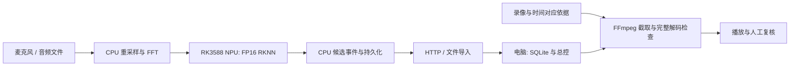

# Basketball Whistle Clips

基于 **RK3588 / LubanCat 5** 的篮球哨声检测与视频片段记录原型。板端负责音频采集、预处理和 NPU 推理，电脑负责事件接收、录像时间映射、片段生成及人工复核。

> 本项目持续开发中。复用开源预训练模型，尚未完成自主微调或识别质量优化；候选需要人工核查。预期性能目标不是实测成绩。

## 项目能力

- **边缘推理**：H5 → ONNX → FP16 RKNN；CPU 重采样/分窗/FFT，NPU 前向，CPU 生成候选事件。
- **持续检测**：有界窗口缓存、跨块事件处理、停止与资源收尾；正常模式不保存连续录音。
- **事件通信**：HTTP / SQLite，事件先保存、事务提交后确认、去重与原标签补发。
- **录像处理**：FFmpeg，基于有依据的时间映射截取事件起点前 5 秒、后 3 秒，文件头尾截断。
- **本地 Web 总控**：显式 SSH 连接、就绪检查、采集启停、状态查询、独立下载校验、候选播放及意见另存。

## 已验证范围与限制

| 范围 | 已有证据 | 边界 |
| --- | --- | --- |
| 文件推理 | RK3588 CPU/NPU 实际运行及输出对照 | 不代表识别准确率已达标 |
| 分块检测 | 210.78 秒四声道文件、9076 窗，同后端分块/整段结果一致 | 文件测试不能代替长期采集 |
| 离线截片 | 指定短视频产生 12 个候选片段，完整解码检查通过 | 12 个候选不等于 12 个真实哨声 |
| 受控实机链路 | 短时真实采集、NPU 检测、非空标签自动接收、软件播放映射与人工位置确认 | 不是独立相机精确 UTC 同步 |
| 总控实机操作 | 约 24 秒、1001 窗，正常停止，10 份结果文件哈希一致 | 该会话零候选，未验证非空标签上传 |

独立相机同步精度、长时间稳定性、完整总控非空事件闭环和识别性能仍待进一步验证。现有模型有误报和重复响应；数据核查及优化准备属于阶段四，尚不等于训练完成或质量提升。

## 运行与目录导航

1. 安装 Python 3.8+ 及 FFmpeg/ffprobe；不同检测后端的 Python/依赖版本另见阶段二说明。FFmpeg 可放入系统 PATH，或按已有脚本约定放入 `tools/ffmpeg-9.0.2-essentials_build/bin/`。
2. Windows 总控入口：[`阶段6_项目展示/start-workbench.cmd`](./阶段6_项目展示/start-workbench.cmd)。打开页面不会自动连接板卡或启动采集。
3. 先用自己的结果及录像执行本地导入；板端运行另需 ALSA、RKNN Lite2、固定模型资产及 SSH 配置。源码克隆不包含可直接运行的模型和数据。
4. 详细操作见[统一总控使用与验收](./阶段6_项目展示/统一总控使用与验收.md)。历史说明中的绝对路径、IP、账户和部署版本为开发现场示例，运行前须改成自己的实际配置。

| 目录 | 内容 |
| --- | --- |
| `阶段1_离线手动触发/` | basketclip、时间映射、视频截取及测试 |
| `阶段2_离线哨声检测/` | 模型适配、分块检测、采集与板端工具 |
| `阶段3_实时传输/` | 标签接收、持久化、补发与测试 |
| `阶段4_音频AI/` | 数据核查、文献与后续优化研究 |
| `阶段5_视频AI/` | 后续规划 |
| `阶段6_项目展示/` | 总控、联调与操作说明 |

## 第三方来源与发布范围

哨声预训练模型来自 [NaoDevils/AudioProcessing](https://github.com/NaoDevils/AudioProcessing) 相关资产，工程复用型号为 WhistleNetMk16；具体训练数据重合及论文资产对应关系尚未完全确认。模型转换使用 [RKNN Toolkit2](https://github.com/airockchip/rknn-toolkit2)，媒体处理使用 [FFmpeg](https://ffmpeg.org/)。使用第三方资产前请核查其各自许可。

本仓库只发布项目源码、测试和说明。不包含数据集、原始音视频、模型权重、虚拟环境、下载的第三方参考工程、FFmpeg 二进制或运行输出；历史文档中的 `data/`、`outputs/` 链接可能指向未公开的本地证据。没有把未公开文件当成克隆后可复现的测试夹具。

本公开副本已移除本机运维记录，并将机器路径、账户及网络配置改为示例。运行前请配置自己的环境；不可直接用于原开发板部署。
