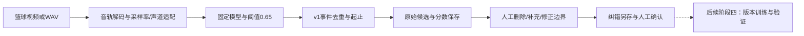
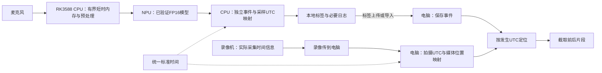
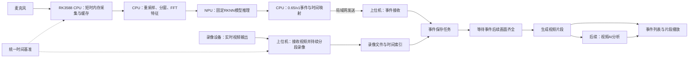

# 篮球哨声事件与比赛录像自动片段记录系统：整体架构

> 2026-10-14当前架构状态：电脑检测/纠错、RK3588 CPU/NPU部署、分块文件接口和12片段相对闭环已限定验收。下一项是持续音频源接现有检测器的本地软件准备；真实采集/UTC、自动哨声上传和跨设备录像映射未完成。原有阶段说明保留，当前顺序及接口以[核心功能闭环规划](./docs/核心功能闭环规划.md)为准。

正常链路的分工已确定：04/04B采集和有界音频输入、NPU检测与采样时间；03复用HTTP/SQLite的事件持久化、提交后ACK、去重和重试；06复用时间映射与FFmpeg，以事件起点前5秒/后3秒截取。相对候选必须在真实采样UTC有依据后才适配成既有四字段，诊断信息另存。既有分块输出仅flush，不据此宣称fsync持久化已具备；自动上传边界需复用阶段一保存顺序。通信队列的长期断网积压和重启恢复尚未验收。

已知短视频3命中组、7非哨声误报、2重复响应保留；本轮不优化模型或规则。正常不保存连续音频，短时调试例外。核心功能正确性包含输入有效、缓存有界、丢样/中断处理和时间依据，不能随性能优化后置而省略。

> 文档状态（2026-10-12）：REC、模拟片段与事件通信有验收；电脑模型推理和篮球失败诊断已有记录。当前先完善电脑检测/标注与纠错原型，再接RK3588；原型质量需人工核对，板端与真实录像同步待验收。文中建议参数不代表性能承诺。最新顺序为先 RK3588、后录像侧，见 [优先开发路线](./docs/RK3588优先开发路线.md)。

> 2026-10-13更新：电脑检测/纠错及RK3588 CPU/NPU单文件对照已通过限定验收。用户确定后续板端模型推理默认使用NPU，CPU负责采集、预处理和事件处理，原H5 CPU推理保留作按需参考。正式入口/有效录音/持续采集/采样UTC/自动通信及真实录像仍待接入与验收；分工确定不代表完整链路已实现。

## 1. 项目目标与需求边界

本项目用于个人兴趣开发和简历展示。先建立一套可运行、可验证的事件记录系统，再分别引入音频与视频 AI。

核心用途：录像设备拍摄比赛，RK3588 检测哨声并记录事件时间标签；电脑上位机将视频与时间标签关联，自动保存哨声前后的比赛片段，供赛后复盘和裁判学习使用。

开发路线：先将现有预训练模型接成电脑完整流程，支持视频/WAV、自动输入适配、事件导出和人工纠错；随后验证RK3588有效拾音、模型兼容性/速度与自动事件通信。使用中积累反馈，阶段四定期训练、验证及版本更新。真实跨设备录像同步、自动片段和实时视频继续后置。

音频工程链路与验收节点见[哨声检测研究路线](./docs/哨声检测研究路线.md)：输入 → 模型 → v1独立事件 → 标注保存 → 人工纠错。复用WhistleNetMk16、0.65/v1；数据分组不是原型启动门槛。已有运行不等于通用流程已完成，当前仅调整路线，不启动训练或部署。

### 已确定需求

- 录像设备负责拍摄。离线版由相机保存录像，实时版向电脑提供视频流。
- 上位机负责视频导入或实时录像、事件接收或导入、片段保存与查看。
- 野火 LubanCat 5（RK3588）负责声音采集、哨声检测和时间标签上传。
- RK3588 与电脑使用统一时间基准；相机录像需额外建立媒体时间与事件时间的映射。
- 正式基础版由哨声自动触发，无须人工逐次标记录像。
- 最初开发阶段在 RK3588 端手动触发，赛后导入录像和事件记录，验证时间关联和片段保存；不要求比赛中联网。
- 后续分别在哨声检测和视频处理中增加 AI。

### 尚未确定

- 摄像头规格、实际录像导出与实时连接方式。电脑已采用 Windows，软件路线为 Python＋FFmpeg。
- 麦克风最终拾音方案、放置位置、预算和实际球场环境。板载咪头及输入路由已核查，有效录音仍待验收。
- 视频前后保留时长、录像质量和可接受定位误差。
- 是否需要现场自动播放；当前只要求自动保存，并提供人工查看或顺序播放。
- 音频与视频 AI 的最终模型和具体功能。

### 当前功能边界

- 哨声事件不等于犯规事件。单凭哨声不能确定判罚类型、犯规队员或判罚是否正确。
- 基础系统提供事件片段，不自动执裁。
- 不将自制原型默认视为符合 FIBA 要求的正式 IRS。
- STM32 NUCLEO-F446RE 暂不进入基础架构；后续有明确的实时控制或外设需求再加入。

## 2. 总体结构

### 2.1 当前电脑检测与标注原型



该原型使用文件内相对时间，不要求连接板卡或先完成真实录像UTC对齐。预测分数不等于已校准概率。候选可误报或漏报，人工纠错不覆盖原预测。

### 2.2 默认系统：统一UTC与赛后录像导入



正常板端音频不落盘、不上传，缓冲中的数据在满足分窗与事件处理需要后释放。录像可以先赛后导入，标签可提前上传；音轨匹配为可选调试/备用校准，当前默认流程不要求两路录音。时间映射依据与验收见[统一时间与最小音频留存](./docs/统一时间与最小音频留存方案.md)。

### 2.3 后续升级：实时传输



## 3. 设备与模块职责

| 模块 | 运行位置 | 职责 |
|---|---|---|
| 比赛会话管理 | 上位机与 RK3588 | 使用同一会话标识关联录像、标签和时间映射；板端录音仅按需调试 |
| 音频采集与预处理 | RK3588 CPU | 持续采集、有界短时内存、重采样/分窗/FFT；正常音频不落盘/上传，记录采样时间关系，持续输入待验收 |
| 模型前向推理 | 电脑CPU；后续板端默认NPU | 板端采用已验证FP16 RKNN，原H5 CPU作按需对照；单文件通过不代表所有输入或在线速度通过 |
| 事件生成 | RK3588 CPU | 固定0.65/v1形成起止与事件；有依据的采样UTC映射通过后再生成通信标签 |
| 人工纠错 | 电脑 | 删误报、补漏报、改边界，保留原预测并另存确认反馈 |
| 模型版本更新 | 电脑训练，RK3588验证 | 使用中保持固定版本，候选另存、验证后替换并可回退 |
| 事件存储与发送 | RK3588 CPU | 先保存本地记录；离线版赛后导出，实时版上传并处理确认与补发；自动哨声接入另验 |
| 视频来源与索引 | 上位机 | 离线版读取导入录像；实时版接收并录制视频；均建立时间索引 |
| 事件接收或导入 | 上位机 | 校验会话，按事件编号去重；网络上传时确认接收 |
| 片段生成 | 上位机 | 按映射定位录像；离线版直接生成，实时版等待画面齐全后生成 |
| 界面与记录 | 上位机 | 展示运行状态、事件状态、片段列表与处理日志 |
| AI 扩展 | 两端分别运行 | 音频端改善触发效果；视频端辅助检索与复盘 |

现有接口支持 JSONL 文件导入；阶段三已实现局域网 HTTP 标签上传和电脑 SQLite 保存，以 (session_id, event_id) 去重，事务保存后返回 label_saved，同编号不同内容拒绝覆盖。实测与限制见[通信验证记录](./阶段3_实时传输/docs/验证记录.md)。短暂断连重试已有合成测试，真实 REC 连通测试通过；自动跨重启恢复及长时间稳定性未验收。确认代表标签保存，不能当作片段已生成。

初期录像设备可使用已有相机。若使用全景相机，需要确认导出的视频可播放；如有拼接或视角转换，时间映射应针对最终用于截取的文件建立，并保留原文件。

## 4. 时间基准与录像定位

### 4.1 统一时间与实际采集关系

两端墙钟采用统一UTC，进程持续计时用单调时钟。记录时间源、偏差、漂移及采集锚点依据；一次校时或同时发出启动命令不能证明帧和音频样本同步。板端采集延迟、相机启动/缓存、声音传播与系统时钟跳变都需核对。

板端按哨声起点的原采样位置换算UTC，不用模型返回或电脑接收时刻替代。丢样、中断及重采样需保留位置关系，必要时重建锚点，正常模式无需保存原始音频。具体方案见[统一时间与最小音频留存](./docs/统一时间与最小音频留存方案.md)。

### 4.2 默认录像映射（离线和实时均需核查）

相机录像导入或实时接收后，电脑必须知道某个媒体位置对应的实际采集UTC。优先核查相机时间码/可靠拍摄时间戳；设备不提供时，需要有依据的外部校准或可验证采集时间的链路。相机型号及能力尚未确认，不假设已有同步接口。导出、拼接、分段、媒体起点非零与中断都须核对。

```text
录像事件位置 Ve = 锚点媒体位置 V0 + (事件UTC Te - 锚点采集UTC T0) × 时间比例 a
```

初始a=1需检查实际比例和长时间漂移。时间跳变/缺失区间分别建立映射，不用一个起点覆盖整场。文件创建时间、开始按钮时间及电脑接收时间不默认等于拍摄起点；无可靠映射时标签可保存，片段保持待对齐。

### 4.3 可选音轨校准与实现边界

两路拍手/声音匹配仅作为调试或备用方案，选择该方式时才按需保存板端同步录音；不作为产品常态留存或必需输入。历史音频/模拟对齐材料保留，不能替代新UTC路线实测。

现有阶段一align/extract支持手工锚点与比例，可使用已核验UTC—录像位置建立对齐文件；自动获取相机时间信息尚未实现。实时采集时间映射也需重新核对，不直接沿用离线偏移。

### 4.4 实时定位示例

以下只是说明，不是实测结果：

- 录像起点对应统一时间：20:00:00.000。
- 哨声开始时间：20:03:12.400。
- 上位机收到标签：20:03:12.650。
- 若映射无偏移，事件对应录像位置为 192.400 秒。
- 保存前 8 秒、后 5 秒，则目标区间为 184.400～197.400 秒。

上位机按发生时间定位，不能按接收时间定位。收到消息时后续画面尚未完整，应排队等待，而不是立即截取不完整片段。

## 5. 事件标签与处理状态

现有 JSONL 与 HTTP 标签沿用以下四字段结构，下面的值仅为示例：

```json
{
  "session_id": "game-001",
  "event_id": 12,
  "event_type": "manual_trigger",
  "event_time_utc": "2026-10-10T12:03:12.400Z"
}
```

上述字段与时间均为示例。正式哨声检测阶段可将类型改为 `whistle`。模型置信度等字段仅在有真实需求时增加。

- `session_id`：关联本场录像，防止跨会话误关联。
- `event_id`：在会话内唯一，用于确认、去重与排查。
- `event_type`：区分手动测试事件与哨声事件。
- `event_time_utc`：事件发生时间；手动版是操作时刻，检测版应尽量对应哨声起点。

离线版状态：已导入 → 待时间对齐 → 可生成 → 生成中 → 已完成或失败。

实时版状态：已接收 → 等待后续画面 → 生成中 → 已完成或失败。接收确认与片段完成是不同状态。

事件先写入 RK3588 本地记录，离线版赛后导入即可。实时版短暂断连时保留待确认事件，重连补发；上位机按会话与事件编号去重。跨断电恢复的完整性需后续单独验证。

## 6. 录像与片段策略

离线首版：相机独立录像，电脑读取赛后导入的可播放文件和事件记录。完成时间对齐后批量截取，无须等待后续画面。

实时升级版：电脑持续分段录制并建立时间索引，收到事件后定位文件，等待画面齐全，再跨分段提取对应范围。

相比内存循环缓存，分段录制便于核对与排错，也能保留整场录像；代价是存储占用更大。循环缓存可以在后续确有需求时再做。

- 前 8 秒、后 5 秒仅为初始试验值。
- 刚开场或比赛结束时，保存已有范围，并记录实际起止时间。
- 实时版生成片段时持续录像不能中断。
- 编码关键帧可能限制直接复制截取的精度；应比较直接复制与重新编码的定位误差、耗时及画质，再选择。
- 算法连续响应同一声哨需要去重；独立事件的片段重叠时，可以共用视频，但保留各自事件记录。

### 离线到实时的复用边界

- 复用：会话与事件字段、去重、事件列表、按时间区间生成片段的逻辑、AI 分析接口。
- 新增或替换：实时视频接收、持续录制、网络事件接收、后续画面等待与断流处理。
- 重新验证：实时采集时间映射、视频传输与缓存延迟、连续录像稳定性。离线标定的偏移不能直接套用到实时视频流。

## 7. 数据留存与 AI 扩展

每场保存录像、事件标签、映射依据、生成片段与必要日志。正常板端音频仅短时内存缓存，处理后释放，不落盘/上传整场录音；调试/有效拾音验收时才明确开启少量独立录音。原有原件、模型、纠错和历史输出保留，不因新默认策略删除。减少音频写入/流量的整机功耗收益待实测。

### 数据、传统基线与音频 AI

阶段二优先复用现有预训练模型实现电脑输入、检测、候选标注和人工纠错。传统v1及v2A失败、数据核查和分组均保留，不要求先把它们完善到性能达标才实现原型。无可信UTC起点的文件只输出相对时间，边界和分数另存，不能直接冒充既有四字段UTC事件。

阶段四按人工纠错批次训练/验证，比较固定现用模型与候选版本的漏检、误触发、起止、耗时及资源。训练/评价再按来源隔离；预测不自动作为训练真值。原权重、ONNX/RKNN派生模型、预处理、阈值与事件规则共同版本化。后续板端默认NPU推理，候选必须验证RKNN转换/数值及实机运行后再替换，保留上一NPU版本和原H5 CPU参考；不兼容候选先保留现用版本。详细要求见[研究路线](./docs/哨声检测研究路线.md)。

本场与邻场哨声区分属于待验证方向。单个麦克风可能缺少来源信息，不应默认模型可以解决。

### 视频 AI

优先分析已生成的事件片段，可考虑人员检测与跟踪，或少量指定裁判手势识别。根据实际机位、人物尺寸和遮挡情况选择一项，不同时堆叠多个功能。

AI 结果作为辅助标签与分析结果保存，不直接当作正式判罚结论。自动判断复杂犯规不属于当前承诺。

## 8. 系统验收重点

- 手动事件到录像的最终定位误差。
- 采样UTC与录像实际采集UTC映射有依据，独立事件定位及长时间漂移可测。
- 正常模式原始音频无落盘/上传，短时缓存有界；调试留存与产品默认分开验证。
- 导入录像与事件是否属于同一会话；媒体时间是否连续。
- 网络延迟变化时的定位一致性。
- 事件丢失、重复及短暂断连后的补发行为。
- 视频保存成功率、可播放性及实际覆盖范围。
- 生成片段期间的录像连续性。
- 长时间运行后时钟偏差和资源占用。
- 哨声检测的漏检率、每小时误触发次数和检测延迟。

以上指标须通过测试获得；在基线测试完成前不承诺具体数值。
